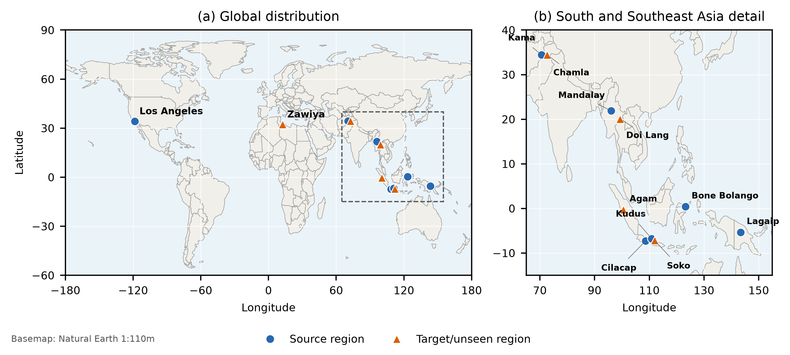
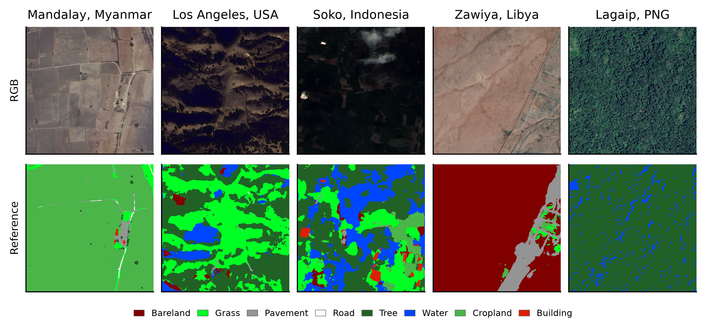
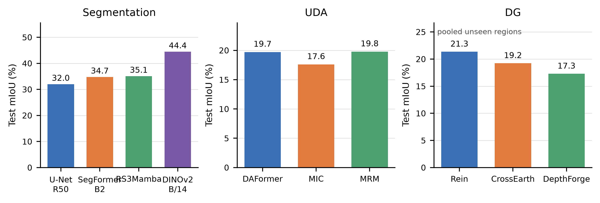

<div align="center">

# GeoLC-8

### Cross-Domain Land-Cover Mapping with Challenging Disaster-Response Imagery

[](https://www.python.org/) [](https://pytorch.org/)    

**[Dataset](https://zenodo.org/records/REPLACE_WITH_ZENODO_RECORD_ID)** · **[Code](https://github.com/REPLACE_WITH_ACCOUNT/GeoLC-8)** · **[Releases](../../releases/latest)**

</div>

<div align="justify">

**GeoLC-8** is a cross-regional optical benchmark for eight-class,
high-resolution land-cover mapping in disaster-response settings. It contains
4,077 quality-controlled RGB patches from 12 regions in eight countries and
four continents. Each patch is 1024 x 1024 pixels at a ground sampling distance
of 0.5--0.75 m. The selected scenes were acquired before, near, or after
earthquake, flood, landslide, and wildfire events, and retain realistic
variation in cloud, haze, illumination, sensor characteristics, landscape, and
surface disturbance.

GeoLC-8 provides OpenEarthMap-compatible generated reference masks,
deterministic regional splits, baseline implementations, and pretrained
checkpoints for supervised semantic segmentation, unsupervised domain
adaptation (UDA), and domain generalization (DG). The label-generation code
can additionally export per-pixel confidence rasters.

</div>

<p align="center">
  
</p>

## Download

> **Release note:** replace the GitHub account and Zenodo record placeholders
> after the repository and dataset record have been created. Do not
> publish the source imagery until provider redistribution terms have been
> verified.

<table align="center">
  <tr align="center">
    <th>Resource</th>
    <th>Contents</th>
    <th>Recommended host</th>
    <th>Download</th>
  </tr>
  <tr align="center">
    <td>GeoLC-8 dataset</td>
    <td align="left">4,077 RGB images, 4,077 masks, and manifests</td>
    <td>Zenodo</td>
    <td><a href="https://zenodo.org/records/REPLACE_WITH_ZENODO_RECORD_ID">Download</a></td>
  </tr>
  <tr align="center">
    <td>Pretrained models</td>
    <td align="left">Optical teacher and ten benchmark checkpoints</td>
    <td>GitHub Releases</td>
    <td><a href="../../releases/latest/download/GeoLC-8_Pretrained_Models.zip">Download</a></td>
  </tr>
  <tr align="center">
    <td>Code and manifests</td>
    <td align="left">Preparation, training, evaluation, fixed splits, and hashes</td>
    <td>GitHub</td>
    <td><a href="https://github.com/REPLACE_WITH_ACCOUNT/GeoLC-8">Repository</a></td>
  </tr>
</table>

## Dataset

<div align="justify">

The dataset covers 12 disaster-affected regions associated with three
earthquakes, four floods, four landslides, and one wildfire. Four selected
scenes predate their nominal events, while eight were acquired near or after
the event. They are independently selected event-context images rather than
co-registered before--after pairs.

Each source image is divided into non-overlapping 1024 x 1024 windows. Partial
edge windows are discarded. A patch is retained only when it contains no
NoData or all-zero RGB pixels and its RGB cloud-proxy fraction does not exceed
0.10. The final collection contains no zero-valued or NoData pixels.

Reference masks are generated by the **original optical OpenEarthMap**
U-Net/EfficientNet-B4 model with four-view flip test-time augmentation. The
OpenEarthMap-SAR optical checkpoint is not used. Every reference mask is paired
with a confidence raster derived from the maximum softmax probability. These
masks are used operationally as ground truth in the benchmark, but they were
not manually corrected and can retain teacher-specific errors.

</div>

<p align="center">
  
</p>

### Land-cover classes

| ID | Class | Official OpenEarthMap color |
|---:|---|---|
| 1 | Bareland | dark red |
| 2 | Grass | bright green |
| 3 | Pavement | gray |
| 4 | Road | white |
| 5 | Tree | dark green |
| 6 | Water | blue |
| 7 | Cropland | medium green |
| 8 | Building | red |

### Dataset structure

```text
GeoLC-8/
├── images/
│   ├── Afghanistan_Kama_000001.tif
│   └── ...
├── labels/
│   ├── Afghanistan_Kama_000001.tif
│   └── ...
├── manifests/
│   ├── experiment_splits.csv
│   └── tiles.csv
└── README.md
```

Image and label files share the same basename, coordinate reference system,
affine transform, width, and height. Patch names follow
`Country_City_NNNNNN.tif`. Confidence rasters can be regenerated with
`pipeline/scripts/infer_openearthmap.py` when required.

## Benchmark protocols

### Semantic segmentation

Patches are shuffled independently within each region using seed 42 and split
6:1:3 into training, validation, and test sets. The same manifest is used for
all four models.

<table align="center">
  <tr align="center">
    <th>Method</th>
    <th>Family</th>
    <th>mIoU (%)</th>
    <th>mF1 (%)</th>
    <th>OA (%)</th>
    <th>BF1 (%)</th>
    <th>Pretrained</th>
  </tr>
  <tr align="center">
    <td>U-Net--ResNet-50</td><td>CNN</td><td>31.97</td><td>46.92</td><td>55.90</td><td>47.35</td>
    <td><a href="../../releases/latest/download/GeoLC-8_Pretrained_Models.zip">Model archive</a></td>
  </tr>
  <tr align="center">
    <td>SegFormer-B2</td><td>Transformer</td><td>34.74</td><td>50.54</td><td>54.81</td><td>41.85</td>
    <td><a href="../../releases/latest/download/GeoLC-8_Pretrained_Models.zip">Model archive</a></td>
  </tr>
  <tr align="center">
    <td>RS3Mamba</td><td>State space</td><td>35.05</td><td>49.89</td><td>57.98</td><td>47.32</td>
    <td><a href="../../releases/latest/download/GeoLC-8_Pretrained_Models.zip">Model archive</a></td>
  </tr>
  <tr align="center">
    <td>DINOv2-B/14</td><td>Foundation model</td><td><b>44.44</b></td><td><b>59.80</b></td><td><b>67.27</b></td><td>28.92</td>
    <td><a href="../../releases/latest/download/GeoLC-8_Pretrained_Models.zip">Model archive</a></td>
  </tr>
</table>

### Unsupervised domain adaptation

The seven larger regions form the source domain. Agam, Zawiya, Chamla,
Doi Lang, and Soko form one pooled target domain. Target training and
validation RGB images are available without labels during adaptation; target
test labels remain hidden until evaluation.

<table align="center">
  <tr align="center">
    <th>Method</th><th>Target mIoU (%)</th><th>mF1 (%)</th><th>OA (%)</th><th>BF1 (%)</th><th>Pretrained</th>
  </tr>
  <tr align="center">
    <td>DAFormer</td><td>19.70</td><td>29.71</td><td><b>49.86</b></td><td><b>50.98</b></td>
    <td><a href="../../releases/latest/download/GeoLC-8_Pretrained_Models.zip">Model archive</a></td>
  </tr>
  <tr align="center">
    <td>MIC</td><td>17.58</td><td>27.80</td><td>41.01</td><td>49.44</td>
    <td><a href="../../releases/latest/download/GeoLC-8_Pretrained_Models.zip">Model archive</a></td>
  </tr>
  <tr align="center">
    <td>MRM</td><td><b>19.76</b></td><td><b>30.22</b></td><td>45.23</td><td>48.59</td>
    <td><a href="../../releases/latest/download/GeoLC-8_Pretrained_Models.zip">Model archive</a></td>
  </tr>
</table>

### Domain generalization

The same five smallest regions are completely withheld during training and
model selection, then evaluated as unseen regions.

<table align="center">
  <tr align="center">
    <th>Method</th><th>Unseen mIoU (%)</th><th>mF1 (%)</th><th>OA (%)</th><th>BF1 (%)</th><th>Pretrained</th>
  </tr>
  <tr align="center">
    <td>Rein</td><td><b>21.35</b></td><td><b>33.00</b></td><td><b>45.05</b></td><td>44.34</td>
    <td><a href="../../releases/latest/download/GeoLC-8_Pretrained_Models.zip">Model archive</a></td>
  </tr>
  <tr align="center">
    <td>CrossEarth</td><td>19.23</td><td>29.59</td><td>43.19</td><td><b>48.72</b></td>
    <td><a href="../../releases/latest/download/GeoLC-8_Pretrained_Models.zip">Model archive</a></td>
  </tr>
  <tr align="center">
    <td>DepthForge</td><td>17.29</td><td>26.96</td><td>40.18</td><td>45.66</td>
    <td><a href="../../releases/latest/download/GeoLC-8_Pretrained_Models.zip">Model archive</a></td>
  </tr>
</table>

<p align="center">
  
</p>

All values are from one fixed-seed run. The RS3Mamba, UDA, and DG experiments
use controlled pure-PyTorch/MPS ports that retain the defining public objective
or module of each method. They are not bit-identical official CUDA/mmseg
reproductions and should not be presented as official reproduced numbers.

## Quick start

```bash
git clone https://github.com/REPLACE_WITH_ACCOUNT/GeoLC-8.git
cd GeoLC-8

python3 -m venv .venv
source .venv/bin/activate
python -m pip install -r requirements.txt
```

Download and extract the Zenodo dataset so that the following paths exist:

```text
pipeline/data/tiles/images/
pipeline/data/pseudo_labels/labels/
pipeline/data/experiment_splits.csv
```

Run one experiment:

```bash
python src/Semantic_Segmentation/train.py \
  --method dinov2_b14_mask2former \
  --device cuda --epochs 15 --input-size 256 \
  --batch-size 8 --workers 4
```

Run all ten methods:

```bash
python pipeline/scripts/run_experiment_suite.py \
  --workspace . --device cuda --epochs 15 \
  --input-size 256 --batch-size 8 --workers 4 --resume
```

Evaluate a released checkpoint:

```bash
python pipeline/scripts/evaluate_checkpoint.py \
  --task dg --method rein \
  --checkpoint pretrained/dg/rein_best.pt \
  --device cuda --input-size 256 --batch-size 8
```

Verify all filenames and checkpoint hashes:

```bash
python pipeline/scripts/verify_release.py
```

## Pretrained model organization

```text
pretrained/
├── teacher/
│   └── openearthmap_unet_efficientnet_b4.pth
├── segmentation/
│   ├── unet_resnet50_best.pt
│   ├── segformer_b2_best.pt
│   ├── rs3mamba_best.pt
│   └── dinov2_b14_mask2former_best.pt
├── uda/
│   ├── daformer_best.pt
│   ├── mic_best.pt
│   └── mrm_best.pt
├── dg/
│   ├── rein_best.pt
│   ├── crossearth_best.pt
│   └── depthforge_best.pt
├── MODEL_ZOO.csv
└── SHA256SUMS
```

## Citation

If you use GeoLC-8, please cite the accompanying manuscript and the original
OpenEarthMap paper used for the taxonomy and optical teacher.

```bibtex
@misc{zhang2026geolc8,
  title  = {GeoLC-8: Cross-Domain Land-Cover Mapping with Challenging Disaster-Response Imagery},
  author = {Zhang, Lianchong and Zhong, Xing and Li, Guoqing},
  year   = {2026},
  note   = {Manuscript}
}
```

## Acknowledgements

This work was supported by the National Earth Observation Science Data Center
of China under Grant E6BG1801 and by the China Science and Technology Exchange
Center Program of China under Grant 2025CSTECGEO004. The authors acknowledge
the organizations that acquired, supplied, and curated the event-organized
disaster-response imagery, including Chang Guang Satellite Technology Co.,
Ltd. The authors also thank the OpenEarthMap team for releasing the optical
benchmark, model implementation, and pretrained weights used to generate the
reference labels.

Lianchong Zhang is the corresponding author
([zhanglc@aircas.ac.cn](mailto:zhanglc@aircas.ac.cn)).

## License and responsible release

The code license and data license have not yet been assigned. Raw imagery must
not be redistributed until the terms of each provider have been verified.
Georeferenced disaster-response imagery may contain sensitive location
information; users should assess privacy and security implications before
publishing derived products.

